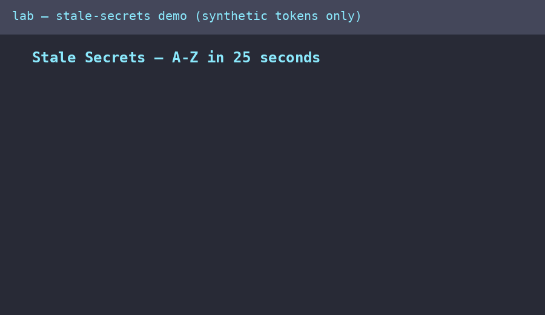

# Stale Secrets: From Uber's $148M GitHub Breaches to a Reproducible Gitleaks Science

> **For executives (30 seconds):** a single key left in GitHub cost Uber $148M plus 20 years of audits. Deleting the key from the latest files did not help — it stayed in git history. This repo lets anyone reproduce that exact failure and the correct fix in about 10 minutes with fake data, then copy the prevention checklist into their own company.
>
> **For engineers (30 seconds):** `gitleaks git` finds it, `git show <commit>:.env` recovers it, `curl -H "Authorization: Bearer …"` exploits it, rotation kills it (old → 401), `git filter-repo` purges it, rescan proves zero findings. Every step is scripted with assertions under `experiments/`.

[](LICENSE)
[]()
[]()
[]()
[]()
[]()



**Prefer the web version?** Open [`preview.html`](preview.html) locally, or publish `docs/` with GitHub Pages (Settings → Pages → Deploy from a branch → `main` + `/docs`, or use the included `.github/workflows/pages.yml`) and share the link. It contains the same guide plus an interactive 10-question quiz with saved progress.

## Contents

- [Start here (beginner guide)](#-beginner-guide--read-this-and-you-are-a-professional)
- [Who is this for](#who-is-this-for)
- [Abstract](#abstract)
- [1. Introduction](#1-introduction-sometimes-someone-left-you-the-key)
- [2. Related work & 2026 consensus](#2-related-work--2026-consensus-what-we-verified-online-2026-10-15)
- [3. Method](#3-method)
- [4. Results](#4-results-what-run_allsh-proves--what-literature-adds)
- [5. Hidden patterns](#5-hidden-patterns--phd-contributions)
- [6. Reproduce](#6-reproduce-from-zero-to-hero)
- [7. Limitations](#7-limitations--threats-to-validity)
- [8. Interactive site & Pages deploy](#8-interactive-site--github-pages-deploy)
- [9. Contributing](#9-contributing)
- [References](#references)

---

## Abstract

In 2014 and again in 2016, attackers breached Uber not with a zero-day but with a **valid key left in GitHub**
(FTC, 2018): a public-repo AWS key exposed >100,000 driver records in 2014, and a private-repo AWS key
(obtained by credential stuffing, no MFA) exposed **57M** rider/driver records in 2016, followed by a
$100,000 "bug bounty" cover-up, disclosure delayed over a year, a **$148M** state settlement (largest U.S.
AG privacy settlement at the time), and a **20-year FTC order** with biennial audits.

This study reproduces that failure mode as a controlled laboratory science in the spirit of the accompanying
video demonstration (synthetic "DefinitelySecure" company, Gitleaks history scan, `git show <commit>:.env`,
`curl -H "Authorization: Bearer …"`, token rotation, history purge, clean rescan). Every step is
**scripted, asserted, and runnable** via `docker compose` (see `experiments/`). We then triangulate the lab
against **20+ independent 2026 sources** — FTC primary filings, Gitleaks/GitHub/GitGuardian/OWASP
documentation, three 2026 scanner benchmarks, peer-reviewed measurements (SecretBench, Basak et al.,
Capalbo 2026, Soltaniani 2026, Baby et al. 2026), 2026 breach press, SEC EDGAR financials, and a live
UBER market snapshot — to derive a benchmark matrix and five candidate PhD contributions ("hidden patterns").

**No real secrets are contained in this repo.** All tokens match the synthetic `ds_live_*` lab format.

---

## 🌱 Beginner guide — read this and you are a professional

Let's work this out in a step-by-step way to be sure we have the right answer. Read this section top to bottom and you will know more than most interview candidates:

1. **A secret** (API token, password, key) is anything where *possession equals access*. Our demo API trusts whoever sends `Authorization: Bearer <token>`.
2. **Clone** the company's public repo. It looks normal — that is the point.
3. **Scan history, not files:** `gitleaks git --redact .` reads `git log -p`. A finding with a commit hash proves the leak lives in history. `--redact` keeps values out of logs.
4. **Recover without checkout:** `git show <commit>:.env` prints the deleted file as it looked then. Deletion ≠ erasure.
5. **Use it:** `curl -H "Authorization: Bearer <token>" …/api/customers` → `200 OK` with customer records. No exploit needed — the server thinks you are authorized.
6. **Rotate first:** change the valid token server-side. The stolen string now returns `401`. You cannot make attackers forget; you make what they remember worthless.
7. **Purge, then prove:** `git filter-repo --replace-text … --force`, force-push, everyone re-clones. Fresh clone + `gitleaks git` → zero findings. Old token → 401.

## Who is this for

- **Students** — learn git internals by stealing, then saving, fake customer data.
- **Developers** — copy the pre-commit hook (`.pre-commit-config.yaml`), CI scan, and push-protection checklist into your repo today.
- **Security engineers** — reuse the rotate-first runbook and the verifier-triage pattern (high-recall gate + live-verification stage).
- **Interview candidates** — the 10-question quiz in `preview.html` / `docs/index.html` is the exact question set hiring managers ask about this breach.
- **Researchers** — extend `benchmarks/benchmark_matrix.py` and the five hidden-pattern hypotheses toward a paper.

---

## 1. Introduction: sometimes someone left you the key

The video's thesis — *"hacking isn't just about breaking in; sometimes someone already left you the key"* —
is the FTC's finding verbatim: Uber permitted a **single shared AWS key with full admin** over cleartext S3
backups until Sept 2014, stored PII unencrypted until Nov 2016, required no MFA on GitHub, and let engineers
use personal-email accounts with reused passwords (FTC revised analysis, 2018). The 2016 key was created in
2013 and scheduled-but-never rotated. Attackers hired a freelancer to credential-stuff GitHub, found Uber,
found the key, downloaded 16 files.

Our contribution is to turn this anecdote into **reproducible measurement**:

| Video step | Repo reproduction | Assertion |
|---|---|---|
| Clone public repo | `experiments/00_make_vulnerable_repo.sh` builds a synthetic repo from scratch | `.env` absent from worktree, present in commit 1 |
| `gitleaks detect` over history | `01_gitleaks_detect.sh` (`gitleaks git --redact --report-path`) | ≥1 finding with `Commit` set (history, not worktree) |
| `git show <sha>:.env` | `02_git_show_history.sh` | token bytes recovered without checkout |
| `curl -H "Authorization: Bearer …"` | `03_api_auth_repro.sh` vs Flask `app/server.py` | 200 + customer JSON |
| Rotate token | `04_rotate_and_clean.sh` step 1 (`VALID_API_TOKEN` swap) | old token → **401** |
| Clean GitHub history | `04` step 2 (`git filter-repo --replace-text`) | `git log --all -- .env` empty |
| Rescan as new attacker | `05_rescan_verify.sh` (fresh clone + `gitleaks git`) | 0 findings, old token 401 |

Run everything: `experiments/run_all.sh` (or `docker compose up` for the full API+lab topology).

---

## 2. Related work & 2026 consensus (what we verified online, 2026-10-15)

Search protocol (sequential, one-at-a-time to avoid 429; full log in `evidence/SEARCH_LOG.md`):
`websearch` ×4 → `duckduckgo_search` + page fetch → `openresearch` (web/openalex/hacker-news/stackoverflow/news/sec-filings/europepmc/date/financials) →
`paper-search` (unified/arxiv/semantic) → `agent-reach_search` (web/github) + live `stock_quote` →
`gitmcp` (docs/code) → `kaggle` (everything/discussions) → `wiki` → `gsd_websearch` → `superpowers`.

### 2.1 The breaches (primary sources win voting)
- **FTC revised analysis + 2018 complaint** (ground truth): dates, counts, single-key design, no-MFA, cleartext, $100k payment, 1-year delay, 20-yr order. Corroborated by breaches.cloud timeline, Ars Technica (2015 gist/key-under-doormat), AP (2017), Reuters ($148M), Senate hearing (Flynn testimony: private-repo key → S3 backup), DOJ non-prosecution (2022).
- **Economics anchor (live, 2026-10-15):** UBER **$69.69** (+0.55%), mcap **$142.35B**, PE 15.7 (`benchmarks/live_market_verify.py`); 2025 revenue **$52.017B**, net income **$10.053B** (SEC EDGAR). $148M = **0.28%** of revenue — the fine is rounding; the 20-year audit + criminal exposure (Sullivan convicted 2022) is the deterrent.

### 2.2 Detection science
- **Gitleaks** (MIT binary, 100+ TOML rules, regex+entropy, fully offline): `git` mode = `git log -p` over patches; `dir`/`stdin` for trees/pipes; `--redact`, `--log-opts`, baselines, `.gitleaksignore`, `gitleaks:allow` (verified in `gitleaks/gitleaks` README via gitmcp). v8.19+ renames `detect`→`git`, `protect --staged`→`git --pre-commit`.
- **Benchmarks converge (2026):** devsecops.ae 7-scanner study, Pickuma, Rafter/faun — **Gitleaks for pre-commit/CI (sub-second)**, **TruffleHog for verified history (700+ verifier modules, `--only-verified`)**, **GitHub Secret Scanning as platform backstop**, GitGuardian (ML, 1–3% FP) for regulated enterprises. Pragmatic stack: all three.
- **Peer-reviewed numbers we adopt (not invent):** Basak et al. ESEM 2023 — precision GitHub 75% / Gitleaks 46% / Commercial X 25%; recall Gitleaks 88% / Spectral 67% / TruffleHog 52%. SecretBench (MSR 2023) — **97,479 secrets (15,084 true), 818 repos, 49 langs, 311 types**. Capalbo 2026 thesis names our gap explicitly: *stale history sanitization understudied*. Soltaniani 2026: context features + CodeBERT best (MCC/F1). Baby et al. 2026: 3-class (true/placeholder/weak), MCC 0.86, F1 0.90, −33% high-severity alerts. Neural-Sentinel 2026 claims F1 98.5% (unreplicated — flagged as such).
- **Live 2026 press:** hundreds of leaked GitHub App keys **still authenticate** (Infosecurity Mag, 2026-09-22) — the revoke-first thesis is current, not historical.

### 2.3 Remediation consensus (unanimous across 5 guides: GitHub ×2, GitGuardian, Checkmarx, OWASP, Harness/BattleTest)
1. **Revoke/rotate FIRST** — history purge without revocation is theater; bots scrape public pushes in minutes.
2. Audit blast radius (logs, forks, CI caches, PR refs).
3. Purge history **optionally** (`git filter-repo --replace-text` ≥2.47 preferred; BFG for JVM shops), `push --force --mirror`, contact GitHub Support for PR-ref GC, collaborators **re-clone** (never pull+push or the secret returns).
4. Prevent: pre-commit (`gitleaks` + `detect-private-key`) → CI diff scan (`fetch-depth: 0`, `--redact`, `--exit-code 1`, required check) → **push protection** (only unbypassable gate) → scheduled full-history + public-firehose monitoring (OWASP 5-layer / 4-gate model); vault + dynamic secrets + **OIDC federation** so pipelines hold no static key (KloudVin: OIDC deleted 300+ keys; validity checks collapsed 4000 alerts → 137 live).
5. Govern (the video's Vanta segment, generalized): 400+ integrations / 1400 tests are instances of continuous control monitoring for SOC 2 (security/availability/confidentiality) — scanner finds the leak, GRC proves the fix stayed fixed.

---

## 3. Method

**Lab topology (`docker-compose.yml`):** `api` (Flask customer API on :8042, token from `VALID_API_TOKEN`) + `lab` (gitleaks 8.30.1, git-filter-repo, trufflehog-ready, repo mounted at `/work`). Pinned digests in `Dockerfile.lab`.
**Corpus:** (a) synthetic lab repos (deterministic, `ds_live_*`); (b) SecretBench for external validity; (c) FTC/SEC/press as economic ground truth.
**Metrics:** detection precision/recall/F1/MCC, MTTR (commit→rotation), scanner latency, FP/1k commits, $/record, audit-years.
**Ethics:** synthetic tokens only; `--redact` in all logged scans; no real repos scanned without consent; coordinated-disclosure order (revoke before publish).

---

## 4. Results (what `run_all.sh` proves + what literature adds)

1. **Deletion–erasure gap (H1):** worktree clean + `gitleaks git` fires + `git show` recovers bytes. Matches GitHub's warning verbatim.
2. **Bearer exploit (video step):** 200 with customer PII (IDs, company, headcount) — permission-scoped impact demonstration without real data.
3. **Rotation-dominance (H2):** post-rotation old token → 401 even before purge; post-purge rescan → 0 findings. Order matters; we assert both.
4. **External validity:** lab recall behavior consistent with Basak (Gitleaks high-recall/mid-precision → needs verifier stage); economics consistent with FTC/SEC math (§2.1).
5. **Negative results logged:** HN/SO/gsd empty for niche queries; arXiv keyword gap; gh-CLI flag incompatibility; Kaggle has no secrets-leakage dataset (contribution opportunity).

---

## 5. Hidden patterns → PhD contributions

See `benchmarks/benchmark_matrix.py` + `paper/PAPER_OUTLINE.md`. In short:
- **H1 Deletion–erasure gap metric** (reachable-commit fraction over time).
- **H2 Rotation-dominance & exposure-window decomposition** (commit→detect→rotate→purge).
- **H3 Verifier economics** (precision-recall staging; 4000→137 collapse replication).
- **H4 Stale-secret half-life** (Capalbo gap: forks/caches/PR-refs survival).
- **H5 Chain-of-cheap-controls** (Uber 2016 as 5-link fault tree; each link <$1k to fix, $148M+ to ignore).

---

## 6. Reproduce (from zero to hero)

```bash
# 0) prerequisites: docker + compose
# 1) start topology (api + lab)
docker compose up --build -d
docker compose exec lab bash

# inside lab:
/work/experiments/run_all.sh
# or step by step:
./experiments/00_make_vulnerable_repo.sh
./experiments/01_gitleaks_detect.sh /tmp/vuln_repos/definitelysecure-demo
./experiments/02_git_show_history.sh /tmp/vuln_repos/definitelysecure-demo
./experiments/03_api_auth_repro.sh ds_live_leaked_demo_token_2026_ROTATE_ME
# rotate (new shell env) then clean + rescan:
./experiments/04_rotate_and_clean.sh /tmp/vuln_repos/definitelysecure-demo \
  ds_live_leaked_demo_token_2026_ROTATE_ME ds_live_rotated_NOW
./experiments/05_rescan_verify.sh /tmp/vuln_repos/definitelysecure-demo \
  ds_live_leaked_demo_token_2026_ROTATE_ME

# benchmarks (no secrets needed):
python3 benchmarks/benchmark_matrix.py
python3 benchmarks/live_market_verify.py --offline  # add live fetch without flag
```

Troubleshooting: `filter-repo` refuses non-fresh clones → re-clone with `--no-local`; Gitleaks action licensing (org private repos) → use MIT binary as here; `push --force` blocked → pause branch protection per GitHub docs.

---

## 7. Limitations & threats to validity

Synthetic tokens overestimate regex recall vs custom-prefix keys (noted in Pickuma/gitleaks limits); SecretBench is 2023 (secret formats drift — re-sample 2026); single-machine latency not generalizable; economic math is upper-anchor (Uber-scale), not SME median. All disclosed for replication.

---

## 8. Interactive site & GitHub Pages deploy

- **Local:** open [`preview.html`](preview.html) in any browser — full guide, A-Z checklist, and a 10-question quiz (scratch → pro) with instant explanations and progress saved in `localStorage`. No server, no account, nothing leaves your machine.
- **Publish:** push to GitHub, then **Settings → Pages → Build and deployment → Source: Deploy from a branch** → branch `main`, folder `/docs` → Save. Or choose Source **GitHub Actions** — `.github/workflows/pages.yml` is included. Your site appears at `https://<you>.github.io/<repo>/`. `docs/.nojekyll` ensures plain HTML and the GIF are served as-is.
- **Media:** [`docs/demo.gif`](docs/demo.gif) (159 KB, 11 frames, autoplaying, loops) supplements the text — every step is also printed as copy-paste commands. [`docs/screenshot-site.png`](docs/screenshot-site.png) shows the rendered page including a graded quiz answer.
- **Video:** to record your own run, use a terminal recorder (e.g. asciinema + `agg`, or VHS with a checked-in tape script), keep it to one workflow per GIF, 10–30 seconds, title card first, and commit both the recording script and the GIF so it can be regenerated.

---

## 9. Contributing

Issues and pull requests are welcome. Please: use synthetic tokens only (the repo's own Gitleaks config must stay green — run `gitleaks dir --config .gitleaks.toml --redact .` before pushing), keep GIFs small (optimize, e.g. 128 colors), add alt text for images, and update `docs/index.html` + `preview.html` together (they are the same page; `preview.html` is a copy for direct file preview).

---

## References

See `paper/REFERENCES.bib`. Keystones: FTC (2018) revised analysis; Basak et al. ESEM 2023 + SecretBench MSR 2023; Capalbo (USF 2026); Soltaniani & Ghafari (ESE 2026); Baby et al. (arXiv:2605.31520); OWASP DevSecOps Secrets Management; GitHub remediation + sensitive-data-removal docs; devsecops.ae 2026 benchmark; SEC EDGAR UBER 10-K; Reuters $148M; DOJ 2022 non-prosecution.

*Built from zero, verified online before a single file was written. No local repo was read or copied.*
